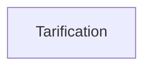

# Context Map — US-2

## Contextes délimités

`Tarification` : Core

- Périmètre : chiffrage du panier — lignes, montants, remises (`docs/adr/adr-001-decoupage-domaine-application.md:8-11`).
  Les paliers de remise y sont cités nommément comme règle commerciale du domaine (`adr-001:8-9, 25-26`).
- Classé Core : ces règles « se discutent avec des gens du métier, changent souvent » et doivent
  survivre au remplacement de l'interface ou du stockage (`adr-001:8-11`).
- Code : `src/Tarification.Domaine/*` et `src/Tarification.Application/CalculDuPanier.cs` ; les deux
  projets forment les deux couches d'un même contexte, pas deux contextes (`adr-001:15-21`).

## Relations entre contextes

Aucune. Le dépôt ne contient que le contexte `Tarification` (projets `Tarification.Domaine` et
`Tarification.Application`, `Tarification.sln`), sans stockage ni service extérieur (`adr-001:40-42`).
La grille de paliers est unique et transmise au cas d'usage (`passation.md:5,9`, `research.md:86`) :
elle n'est fournie par aucun autre contexte dans US-2.

