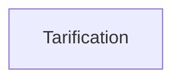

# Context Map — US-2

## Contextes délimités

- `Tarification` : Core

`Tarification` est le seul contexte du projet : la solution ne contient que `Tarification.Domaine`
et `Tarification.Application` (`docs/adr/adr-001-decoupage-domaine-application.md:15-21`). Il est
Core parce qu'il porte les règles commerciales qui « se discutent avec des gens du métier, changent
souvent » — paliers de remise cités en premier (`adr-001:8-11`). La remise par palier en fait partie :
même langage (`Montant`, `Quantite`, `LigneDePanier`), même équipe, mêmes projets.

`Tarification.Domaine` et `Tarification.Application` sont des **couches** d'un même contexte, pas deux
contextes : la relation entre elles est la règle de dépendance de l'ADR-001 (`adr-001:17-21`), pas un
patron de context mapping.

## Relations entre contextes

Aucune. US-2 n'introduit aucun contexte amont ni aval : la grille de paliers est commune à toutes les
références (réponse utilisateur) et n'est lue dans aucun catalogue — l'ADR-001 repousse un catalogue à
l'US-6 (`adr-001:40-42`), et l'approche « paliers par référence » est écartée (`.skraft/us-2/research/research.md:78-79`).

