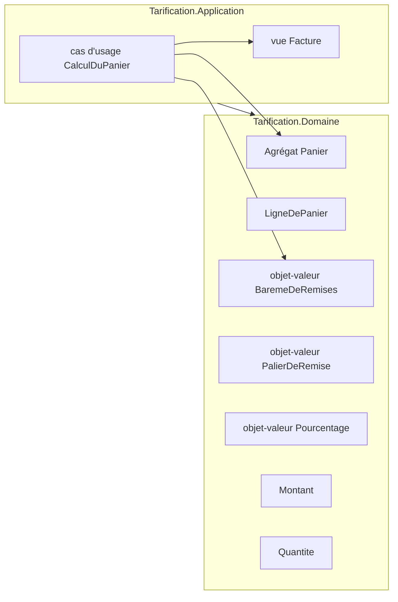
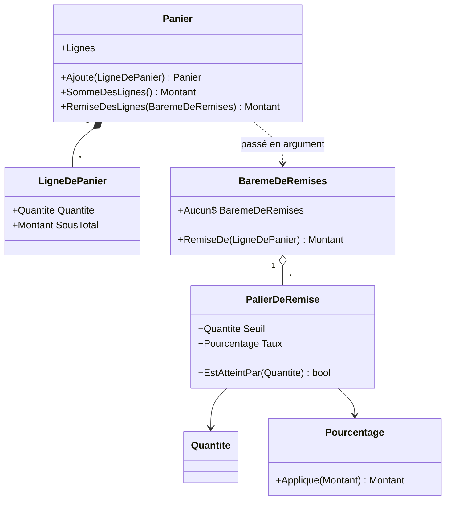
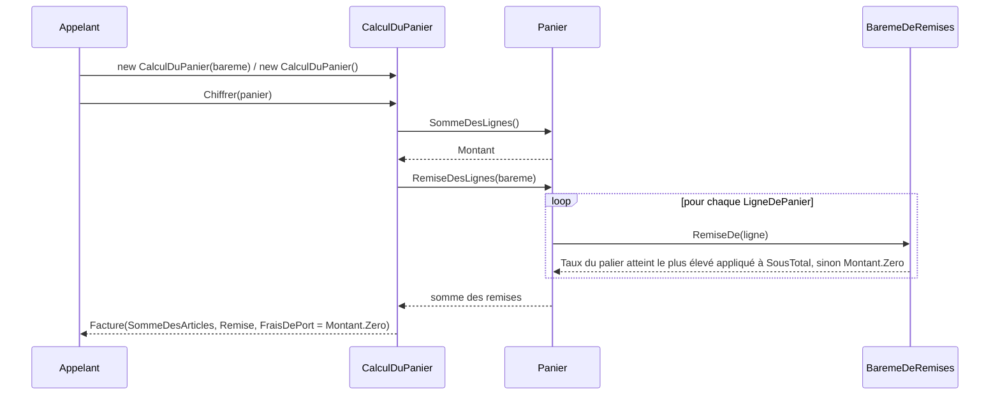

# Diagrammes — US-2 Remise par palier de quantité

Sources : `.skraft/us-2/design/domain-model.md`, `.skraft/us-2/design/contracts.md`,
`docs/adr/adr-003-remise-par-palier-dans-l-agregat-panier.md`.

## Couches et dépendances

Il y a deux couches et une seule direction de dépendance (`docs/adr/adr-001-decoupage-domaine-application.md:15-21`).

## Modèle du domaine

L'Agrégat `Panier` ne garde pas de référence au barème : celui-ci est passé en argument (ADR-003).

## Séquence de la Requête `ChiffrerLePanier`

