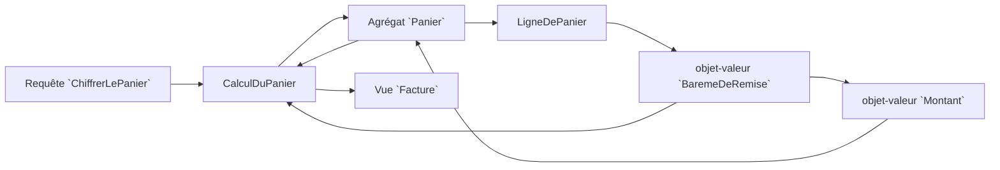
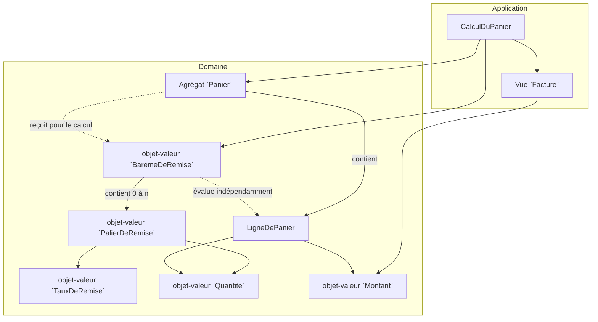

# Diagrammes — US-2

## Flux de lecture proposé

La Requête `ChiffrerLePanier` est réalisée par `CalculDuPanier` et retourne la Vue `Facture`, sans événement. Le panier additionne des remises évaluées ligne par ligne ; le barème est fourni à l'appel et n'est pas persisté (`.skraft/us-2/design/event-model.md:6-15` ; `stories/US-2.md:9-11` ; `docs/adr/adr-001-decoupage-domaine-application.md:28-30,40-42`).

Les flèches représentent les entrées et résultats du calcul, pas des dépendances de projets ou des mutations. Les sous-totaux restent bruts et la Vue `Facture` retranche la remise du total (`src/Tarification.Domaine/LigneDePanier.cs:6` ; `src/Tarification.Domaine/Panier.cs:16` ; `.skraft/us-2/design/clarifications.md:5-7`).

## Composition et couches

Le diagramme conserve la direction application → domaine de l'ADR-001 ; la composition du panier existe déjà, celle du barème représente les seuils et taux des critères (`docs/adr/adr-001-decoupage-domaine-application.md:14-21` ; `src/Tarification.Domaine/Panier.cs:6-14` ; `stories/US-2.md:7-9`).

L'objet-valeur `BaremeDeRemise` n'est pas un agrégat et ne fait pas partie de l'état du panier : la frontière est proposée dans `docs/adr/adr-003-frontiere-du-panier.md:19-29`. Les taux sont compris entre 0 et 100 inclus, les seuils en double sont admis, et le résultat reste une seule remise maximale par ligne (`.skraft/us-2/design/clarifications.md:5-7` ; `stories/US-2.md:9-10`).
