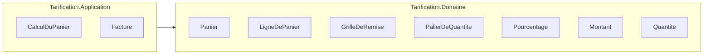
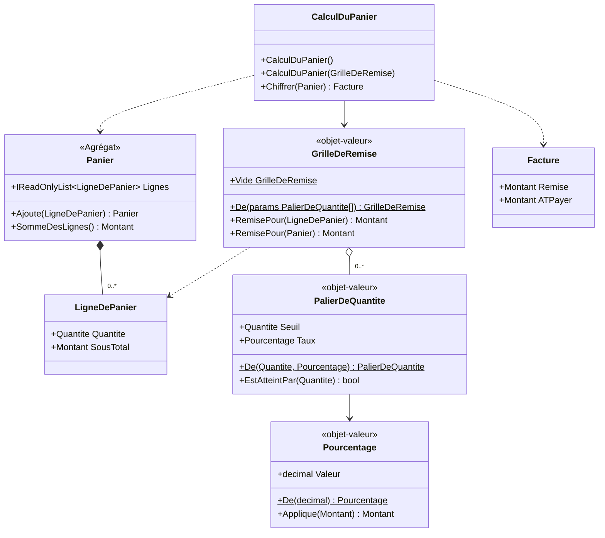
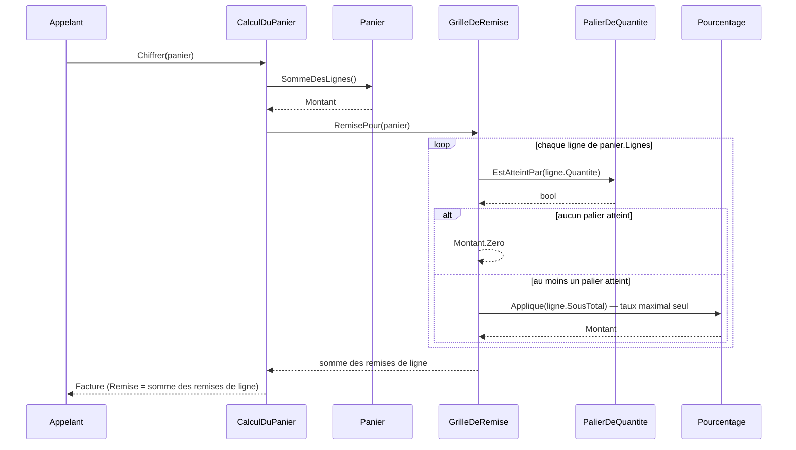
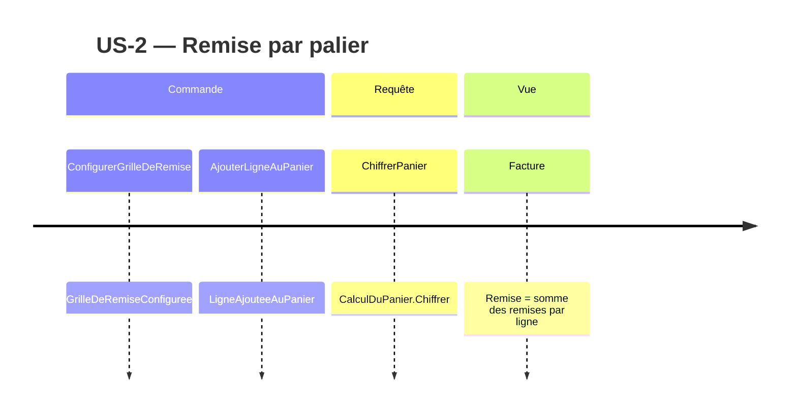

# Diagrammes — US-2 Remise par palier de quantité

Sources : `domain-model.md`, `event-model.md`, `contracts.md`, ADR-001
(`docs/adr/adr-001-decoupage-domaine-application.md:15-21`), ADR-003
(`docs/adr/adr-003-frontiere-du-panier-et-grille-de-remise.md`).

## Couches et dépendances

Une seule direction de dépendance (`adr-001:15-21`) ; les nouveaux types sont dans le domaine
(`domain-model.md:36-74`).

## Modèle du domaine

Le `Panier` reste inchangé ; objet-valeur `GrilleDeRemise` hors de sa frontière (ADR-003).

## Requête `ChiffrerPanier`

Déroulé de `CalculDuPanier.Chiffrer` (`contracts.md`, section « Requête `ChiffrerPanier` »).

## Timeline

Reprise de `event-model.md:52-62`.

