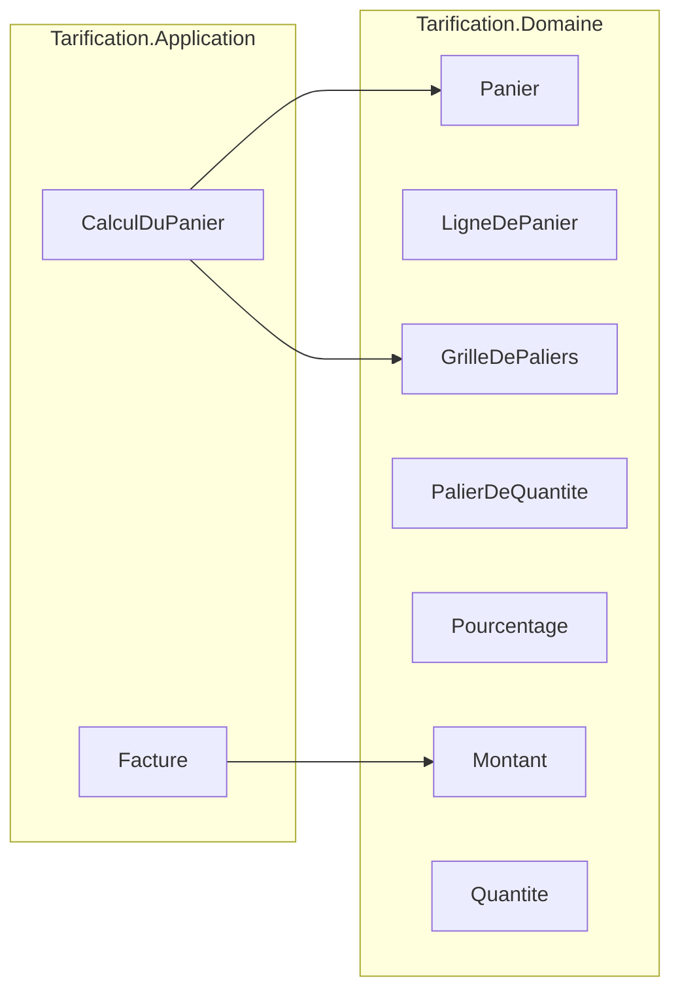
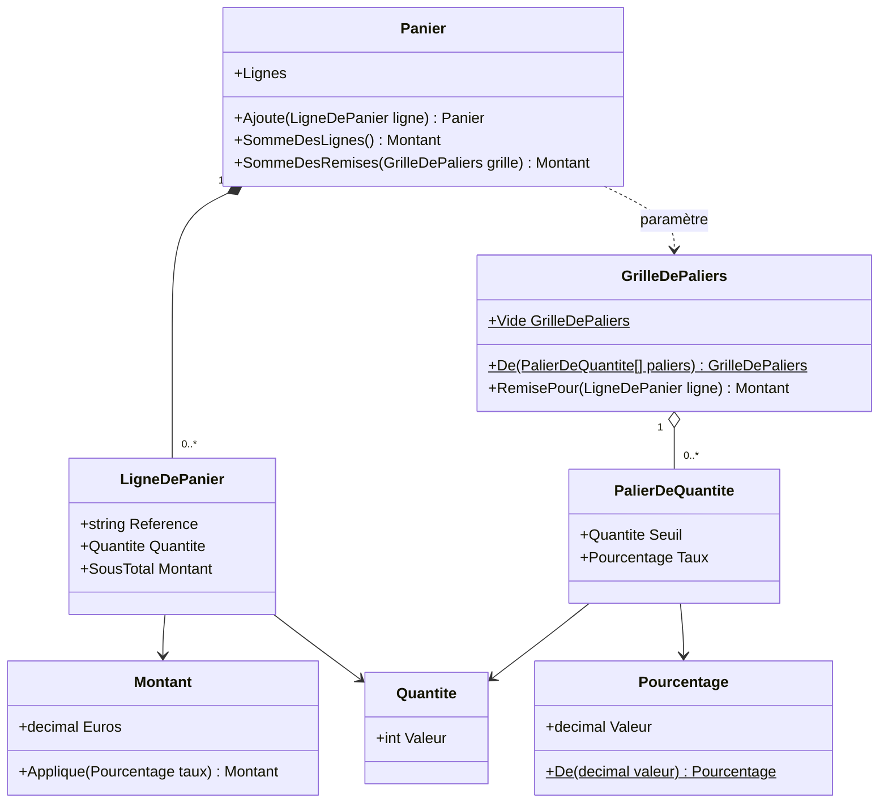
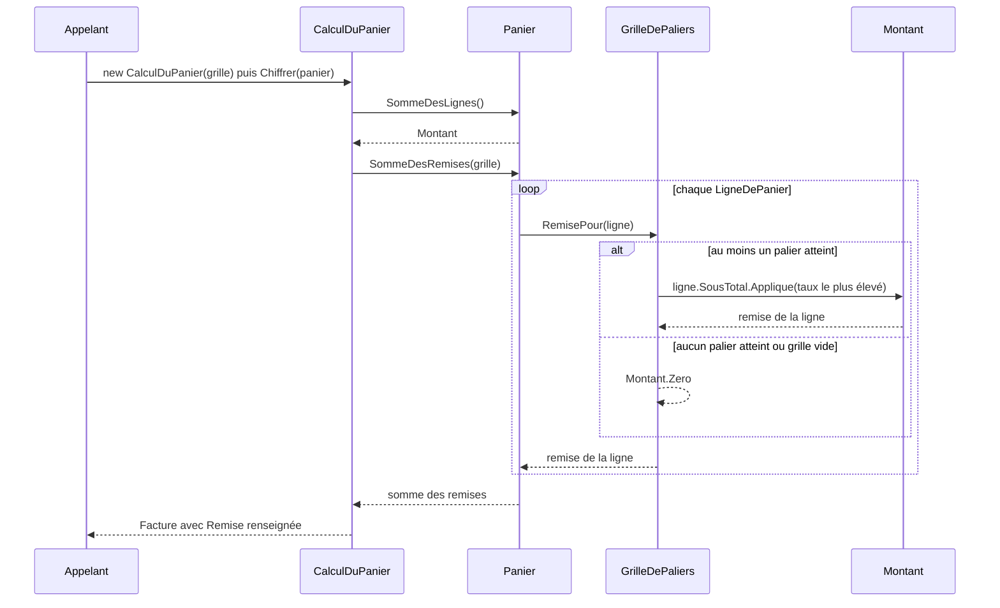

# Diagrammes — US-2 : Remise par palier de quantité

Sources : `.skraft/us-2/design/domain-model.md`, `.skraft/us-2/design/event-model.md`,
`.skraft/us-2/design/contracts.md`.

## Dépendances entre couches

Une seule direction : l'application dépend du domaine, le domaine de rien
(`docs/adr/adr-001-decoupage-domaine-application.md:15-21`).

## Modèle du domaine

Nouveaux : `GrilleDePaliers`, `PalierDeQuantite`, `Pourcentage`, `Panier.SommeDesRemises`,
`Montant.Applique` (`domain-model.md:12-22`). `GrilleDePaliers` n'est pas tenue par `Panier` : elle lui
est passée au calcul (`domain-model.md:30-31`).

## Requête `ChiffrerPanier`

Calcul ligne par ligne, un seul palier retenu par ligne (`contracts.md`, section « Requête
`ChiffrerPanier` » ; `stories/US-2.md:9-10`).

## Commande `AjouterLigne` → Événement `LigneAjoutee`

Existant, inchangé (`event-model.md:13,27-31`, `src/Tarification.Domaine/Panier.cs:10-14`).

