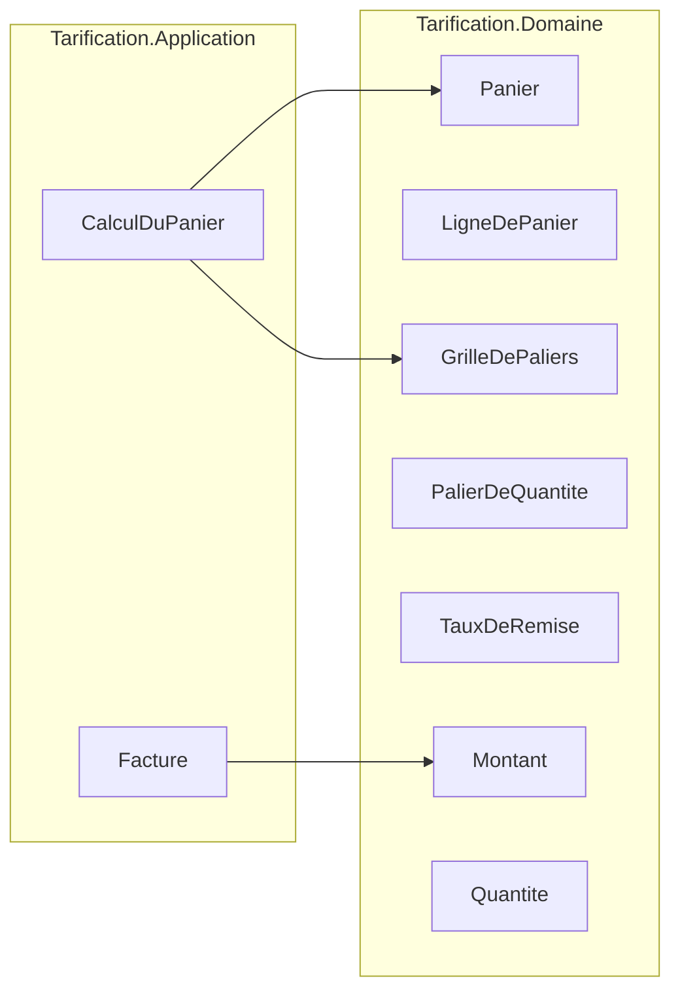
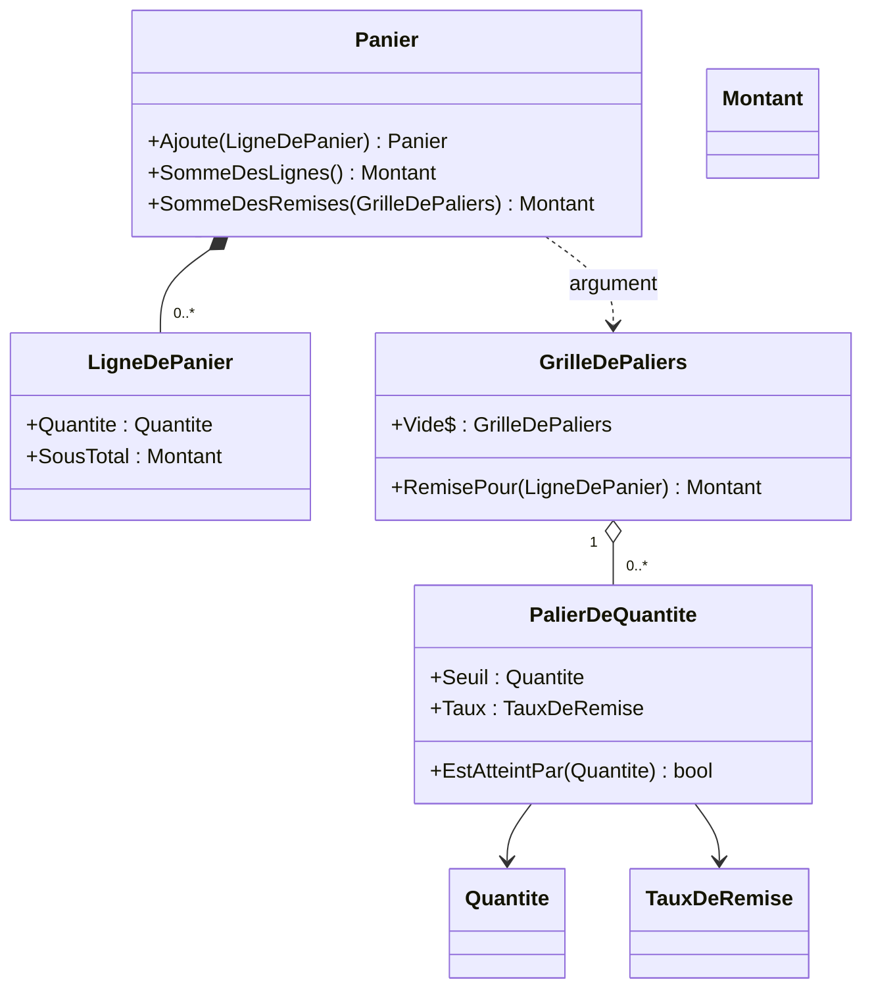
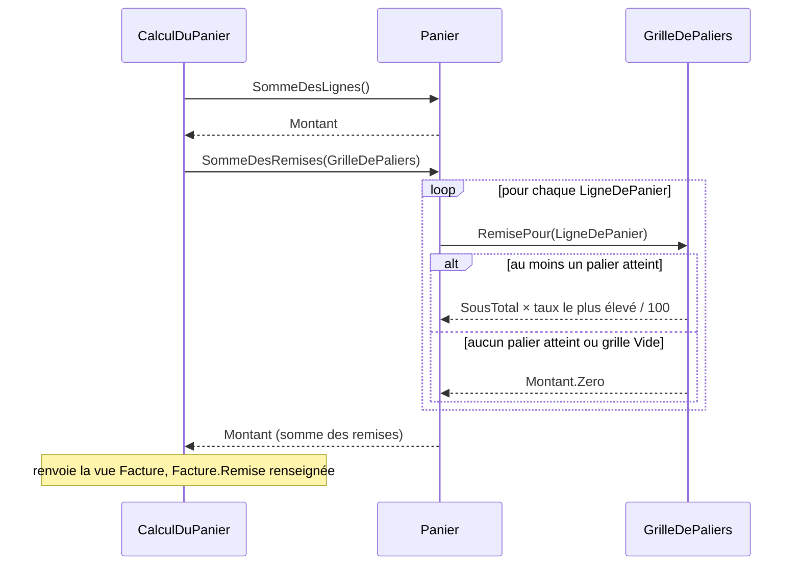

# Diagrams — US-2 Remise par palier de quantité

Sources : `contracts.md`, `domain-model.md`, `event-model.md`, couches selon
`docs/adr/adr-001-decoupage-domaine-application.md:17-21`.

## Couches et dépendances

Le domaine ne dépend de rien ; l'application dépend du domaine seul (`adr-001:15-21`).

## Modèle du domaine

## Séquence de la requête `ChiffrerLePanier`

La remise n'entre pas dans `ATPayer` (`CalculDuPanier.cs:12`, `passation.md:9`).
