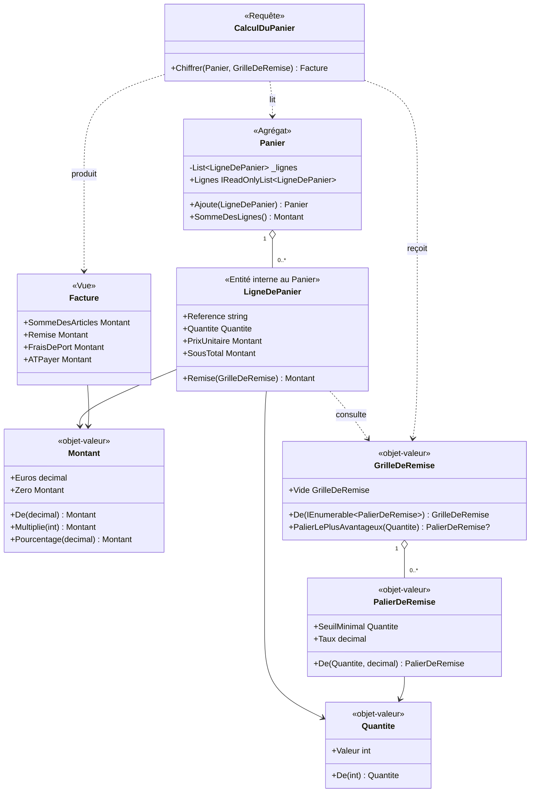
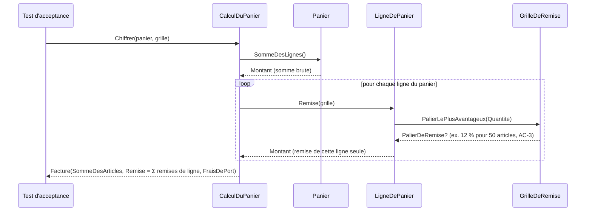
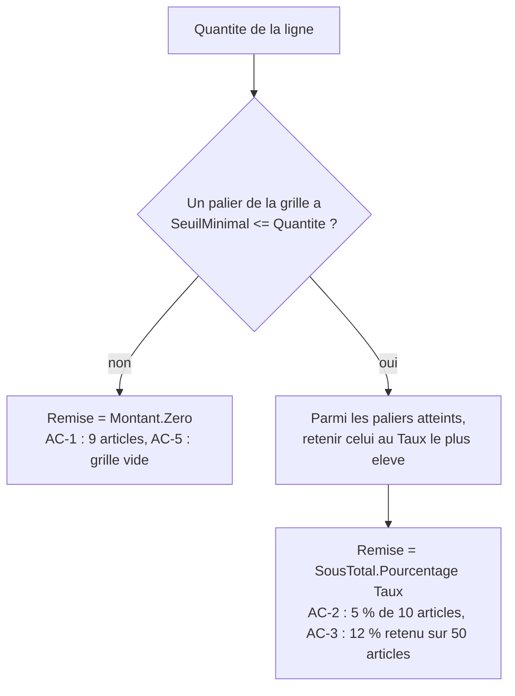

# Diagrams — US-2 — Remise par palier de quantité

Mêmes catégories que `contracts.md` et `domain-model.md` : agrégat `Panier`, objets-valeurs
`Montant`, `Quantite`, `PalierDeRemise`, `GrilleDeRemise`, requête `Chiffrer`.

## Diagramme de classes — domaine et application

Source des bornes de dépendance : `Tarification.Domaine` (en-dessous du trait) ne dépend de rien ;
`Tarification.Application` (`CalculDuPanier`, `Facture`) dépend du domaine et de lui seul
(`docs/adr/adr-001-decoupage-domaine-application.md`, section Décision).

## Diagramme de séquence — requête `Chiffrer` (AC-3 : deux paliers, un seul retenu)

## Diagramme d'état — sélection du palier le plus avantageux (AC-1, AC-2, AC-3, AC-5)

AC-4 n'apparaît dans aucun diagramme ci-dessus comme un cas particulier : la boucle du diagramme
de séquence applique `Remise` ligne par ligne, chaque ligne ne consultant que sa propre
`Quantite` — deux lignes de 6 articles de références différentes produisent chacune une remise
nulle sans qu'aucune donnée ne soit partagée entre elles.
