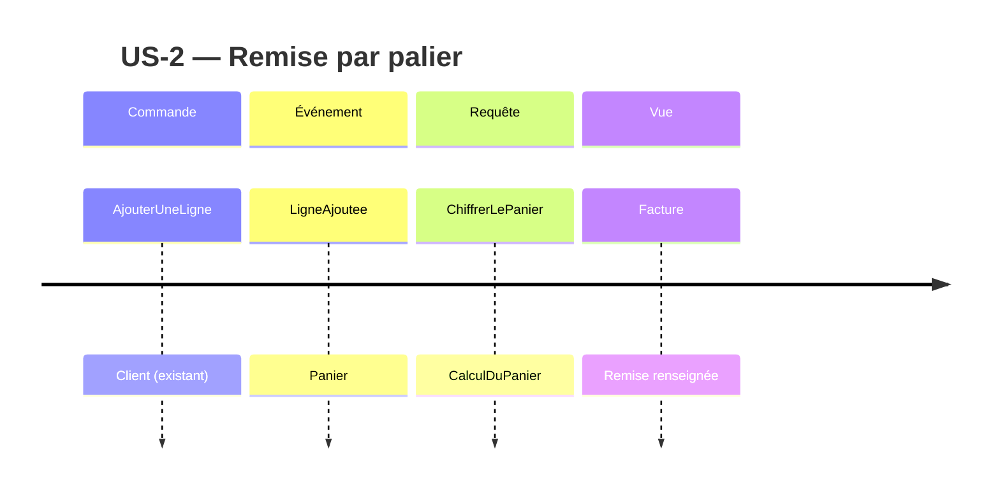

# Event Model — US-2 Remise par palier de quantité

Sources : `stories/US-2.md:7-11` (critères), `.skraft/us-2/passation.md:5,9` (grille unique, remise
seulement renseignée dans `Facture.Remise`), `.skraft/us-2/research/research.md:83-91` (approche A retenue).

## Agrégat concerné

`Panier` (`src/Tarification.Domaine/Panier.cs:4-17`) : seul agrégat de la tranche. Il porte les lignes
et, avec US-2, la somme des remises calculées ligne par ligne.

## Commandes

| Commande | Événement | Agrégat | Rôle dans US-2 |
|---|---|---|---|
| `AjouterUneLigne` | `LigneAjoutee` | `Panier` | État préalable (« Soit ») de chaque critère : existant, `Panier.Ajoute` (`Panier.cs:10-14`), réutilisé sans changement |

Commande `AjouterUneLigne` → événement `LigneAjoutee`.

Aucune commande nouvelle : aucun critère de US-2 ne modifie l'état. La grille de paliers est une
donnée de configuration transmise au cas d'usage (`research.md:86`), pas un changement d'état du
`Panier`. L'événement `LigneAjoutee` est conceptuel : le code actuel ne publie aucun événement
(`Panier.cs:10-14`) et US-2 n'en demande pas la matérialisation.

## Requêtes

Requête `ChiffrerLePanier` → vue `Facture`.

- Point d'entrée : `CalculDuPanier.Chiffrer(Panier)` (`src/Tarification.Application/CalculDuPanier.cs:19-21`).
- Vue : `Facture(SommeDesArticles, Remise, FraisDePort)` (`CalculDuPanier.cs:10-13`). US-2 renseigne
  `Remise` (aujourd'hui `Montant.Zero`, `CalculDuPanier.cs:21`) ; `ATPayer` reste inchangé
  (`CalculDuPanier.cs:12`, `passation.md:9`).
- Lecture : `Panier.SommeDesRemises(GrilleDePaliers)` sur l'agrégat `Panier`, la remise de chaque ligne
  étant donnée par `GrilleDePaliers.RemisePour(LigneDePanier)` (voir `domain-model.md`).

## Tranches verticales (une par critère)

| Critère | Déclencheur | Événement préalable (Soit) | Vue lue (Alors) |
|---|---|---|---|
| ac-1 — palier 10 : 5 %, 9 × 2,00 € → 0,00 € | Requête `ChiffrerLePanier` | `LigneAjoutee` ×1 | `Facture.Remise` = 0,00 € |
| ac-2 — palier 10 : 5 %, 10 × 2,00 € → 1,00 € | Requête `ChiffrerLePanier` | `LigneAjoutee` ×1 | `Facture.Remise` = 1,00 € |
| ac-3 — paliers 10 : 5 % et 50 : 12 %, 50 × 2,00 € → 12,00 € | Requête `ChiffrerLePanier` | `LigneAjoutee` ×1 | `Facture.Remise` = 12,00 € |
| ac-4 — 2 lignes de 6, références différentes, palier 10 → 0,00 € | Requête `ChiffrerLePanier` | `LigneAjoutee` ×2 | `Facture.Remise` = 0,00 € |
| ac-5 — aucun palier → 0,00 € | Requête `ChiffrerLePanier` | `LigneAjoutee` ×1 | `Facture.Remise` = 0,00 € |

Correspondance Gherkin (skill `architecture-patterns`, « Relationship to Gherkin ») : « Soit » = grille de
paliers configurée + `LigneAjoutee` ; « Quand » = `ChiffrerLePanier` ; « Alors » = `Facture.Remise`.

## Charges utiles

Section ajoutée en fin de document pour ne pas décaler les lignes citées ailleurs.

| Élément | Champs | Source |
|---|---|---|
| Commande `AjouterUneLigne` | `Reference` (`string`), `Quantite` (`Quantite`), `PrixUnitaire` (`Montant`) | `LigneDePanier.cs:4`, `Panier.cs:10` |
| Événement `LigneAjoutee` | `Reference`, `Quantite`, `PrixUnitaire` de la ligne ajoutée | `LigneDePanier.cs:4` |
| Requête `ChiffrerLePanier` | `Panier` (argument de `Chiffrer`), `GrilleDePaliers` (constructeur de `CalculDuPanier`, défaut `GrilleDePaliers.Vide`) | `CalculDuPanier.cs:21`, `research.md:86, 112` |
| Vue `Facture` | `SommeDesArticles`, `Remise`, `FraisDePort`, `ATPayer` | `CalculDuPanier.cs:10-13` |
