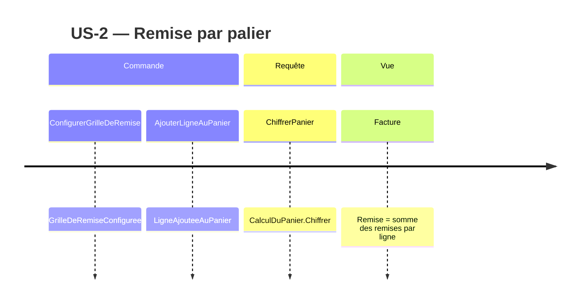

# Event Model — US-2 Remise par palier de quantité

Sources : `stories/US-2.md:7-11` (critères), `.skraft/us-2/research/research.md:61-83` (approche A retenue).

## Nature des déclencheurs

Le chiffrage ne modifie aucun état : `CalculDuPanier.Chiffrer` reçoit un `Panier` et rend une
`Facture` neuve (`src/Tarification.Application/CalculDuPanier.cs:19-22`). C'est donc une **requête**.
Les seules modifications d'état sont celles qui préparent le « Étant donné » de chaque critère :
la constitution de la grille de paliers et l'ajout de lignes au panier (`src/Tarification.Domaine/Panier.cs:10-14`).

Le projet ne contient aucun type d'événement ni aucun stockage (`docs/adr/adr-001-decoupage-domaine-application.md:40-42`) :
les événements ci-dessous sont des faits métier de la timeline, pas des classes à créer.
Aucun Event Sourcing : l'historique des chiffrages n'a pas de valeur exigée par la story (`stories/US-2.md:1-14`).

## Commandes (préparation de l'état)

| Commande | Événement | Agrégat / objet | Existant |
|---|---|---|---|
| `AjouterLigneAuPanier` | `LigneAjouteeAuPanier` | `Panier` | oui — `Panier.Ajoute` (`Panier.cs:10-14`) |
| `ConfigurerGrilleDeRemise` | `GrilleDeRemiseConfiguree` | `GrilleDeRemise` | non — à créer (fabrique de la grille, passée au cas d'usage) |

- Commande `AjouterLigneAuPanier` → événement `LigneAjouteeAuPanier`. Jamais rejetée par US-2 ; les
  rejets existants portent sur `Quantite` (`Quantite.cs:10-11`) et `Montant` (`Montant.cs:13-14`).
- Commande `ConfigurerGrilleDeRemise` → événement `GrilleDeRemiseConfiguree`. Rejetée si un palier est
  invalide (seuil < 1 : `Quantite.cs:10-11` ; pourcentage hors bornes, voir `domain-model.md`).
  Une grille vide est acceptée (critère 5, `US-2.md:11`).

### Charges utiles des événements

| Événement | Charge utile | Source |
|---|---|---|
| `LigneAjouteeAuPanier` | `Reference` (`string`), `Quantite` (`Quantite`), `PrixUnitaire` (`Montant`) — sur l'Agrégat `Panier` | `src/Tarification.Domaine/LigneDePanier.cs:4` |
| `GrilleDeRemiseConfiguree` | `Paliers` : liste, éventuellement vide, de `PalierDeQuantite` (`Seuil`, `Taux`) — Objet-valeur `GrilleDeRemise` | `domain-model.md` |

## Requête (déclencheur de chaque critère)

- Requête `ChiffrerPanier` → vue `Facture`.

Implémentée par `CalculDuPanier.Chiffrer(Panier)` (`CalculDuPanier.cs:21`), la grille étant fournie
au cas d'usage à sa construction (`adr-001:28-30`, `research.md:62,83`). La vue `Facture` existe
(`CalculDuPanier.cs:10`) ; son champ `Remise`, aujourd'hui figé à `Montant.Zero` (`CalculDuPanier.cs:21`),
devient la somme des remises calculées ligne à ligne.

Champs de la vue `Facture` (`CalculDuPanier.cs:10-12`) :

| Champ | Type | Après US-2 |
|---|---|---|
| `SommeDesArticles` | `Montant` | inchangé (`Panier.SommeDesLignes`, `Panier.cs:16`) |
| `Remise` | `Montant` | somme des remises par ligne |
| `FraisDePort` | `Montant` | inchangé, `Montant.Zero` (`CalculDuPanier.cs:21`) |
| `ATPayer` | `Montant` | inchangé : `SommeDesArticles` + `FraisDePort` (`CalculDuPanier.cs:12`) |

## Tranches verticales (une par critère)

| Critère | Étant donné (commandes) | Quand (requête) | Alors (vue) |
|---|---|---|---|
| ac-1 (`US-2.md:7`) | `GrilleDeRemiseConfiguree` {10 → 5 %} ; `LigneAjouteeAuPanier` 9 × 2,00 € | `ChiffrerPanier` | `Facture.Remise` = 0,00 € |
| ac-2 (`US-2.md:8`) | `GrilleDeRemiseConfiguree` {10 → 5 %} ; `LigneAjouteeAuPanier` 10 × 2,00 € | `ChiffrerPanier` | `Facture.Remise` = 1,00 € |
| ac-3 (`US-2.md:9`) | `GrilleDeRemiseConfiguree` {10 → 5 %, 50 → 12 %} ; `LigneAjouteeAuPanier` 50 × 2,00 € | `ChiffrerPanier` | `Facture.Remise` = 12,00 € (un seul palier) |
| ac-4 (`US-2.md:10`) | `GrilleDeRemiseConfiguree` {10 → 5 %} ; deux `LigneAjouteeAuPanier` de 6 articles, références différentes | `ChiffrerPanier` | `Facture.Remise` = 0,00 € |
| ac-5 (`US-2.md:11`) | `GrilleDeRemiseConfiguree` {} (aucun palier) ; une ligne quelconque | `ChiffrerPanier` | `Facture.Remise` = 0,00 € |

Note ac-4 : le prix unitaire n'est pas donné par le critère (`US-2.md:10`) ; le résultat (0,00 €) n'en dépend pas.

## Timeline

## Choix « option la plus simple » (réponses utilisateur)

- Grille unique pour toutes les références (réponse utilisateur ; `research.md:54`).
- Deux lignes de même référence ne s'additionnent pas : chaque ligne est évaluée seule (critère 4
  « par ligne », `US-2.md:10` ; `Panier.Ajoute` n'agrège pas, `Panier.cs:10-14`).
- Aucun arrondi dans cette story (US-5, `stories/US-5.md:9`) ; les valeurs des critères sont exactes (`research.md:55`).
- Pas de cumul avec un code promo modélisé (US-3, `stories/US-3.md:14`).
- `Facture.ATPayer` inchangé (`CalculDuPanier.cs:12`) : aucun critère US-2 n'exige d'y soustraire la remise (`US-2.md:7-11`).
