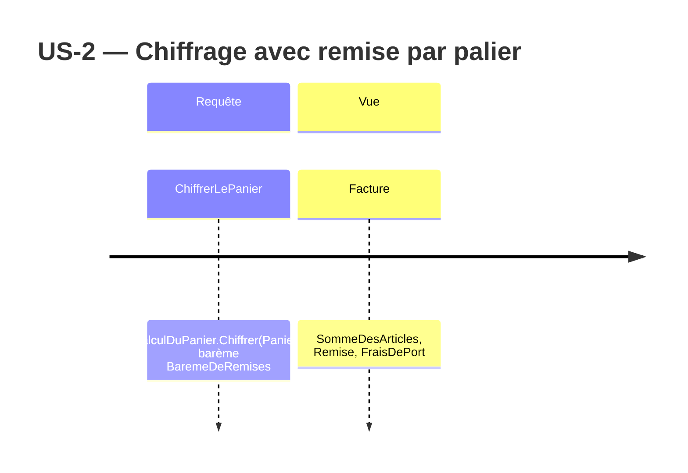

# Event Model — US-2 Remise par palier de quantité

## Nature des déclencheurs

Aucun critère d'US-2 ne change un état : chacun fixe un barème et un panier (« Soit »), puis lit la
remise qui ressort du chiffrage (« Alors ») (`stories/US-2.md:7-11`). Le chiffrage est un calcul pur.
`CalculDuPanier.Chiffrer(Panier)` retourne une `Facture` sans rien modifier ni stocker
(`src/Tarification.Application/CalculDuPanier.cs:19-21`), et le projet n'a pas de stockage
(`docs/adr/adr-001-decoupage-domaine-application.md:40-41`).

Le déclencheur de chaque tranche est donc une **requête**. US-2 n'ajoute **aucune commande** et
**aucun événement**.

Les préconditions ne sont pas des commandes de cette story :
- remplir le panier passe par `Panier.Ajoute`, qui existe déjà (US-1, `src/Tarification.Domaine/Panier.cs:10-14`) ;
- le barème `BaremeDeRemises` est une valeur que l'appelant fournit au cas d'usage. Les critères
  disent « palier configuré » (`stories/US-2.md:7-11`) et ne décrivent aucune action pour le
  configurer.

## Requête

Requête `ChiffrerLePanier` → vue `Facture`

- Entrée : un `Panier` et le `BaremeDeRemises` fourni à `CalculDuPanier` (une liste globale, la
  même pour toutes les références : `.skraft/us-2/passation.md:5`, `:10`).
- Rejets possibles : aucun à l'exécution pour un argument nul. La nullité est refusée à la
  compilation (`Directory.Build.props:4`, `:7-8`), comme pour le code existant (`CalculDuPanier.cs:21`).
  Un palier invalide est refusé quand on le construit (`ArgumentOutOfRangeException` de
  `Pourcentage.De` ou de `Quantite.De`), jamais pendant la requête. Voir `domain-model.md`, section
  « Arguments nuls ».
- Vue : `Facture` existante (`CalculDuPanier.cs:10`). Son champ `Remise` contient la somme des
  remises calculées ligne par ligne. Aujourd'hui il vaut toujours `Montant.Zero` (`CalculDuPanier.cs:21`).

## Tranches verticales (une par critère)

| Critère | Précondition (Soit) | Déclencheur | Vue lue (Alors) |
|---|---|---|---|
| ac-1 | barème [10 → 5 %], ligne de 9 × 2,00 € | Requête `ChiffrerLePanier` | `Facture.Remise` = 0,00 € |
| ac-2 | barème [10 → 5 %], ligne de 10 × 2,00 € | Requête `ChiffrerLePanier` | `Facture.Remise` = 1,00 € |
| ac-3 | barème [10 → 5 %, 50 → 12 %], ligne de 50 × 2,00 € | Requête `ChiffrerLePanier` | `Facture.Remise` = 12,00 € (un seul palier) |
| ac-4 | barème [10 → 5 %], deux lignes de références différentes à 6 articles | Requête `ChiffrerLePanier` | `Facture.Remise` = 0,00 € (chaque ligne est évaluée seule) |
| ac-5 | barème vide (`BaremeDeRemises.Aucun`) | Requête `ChiffrerLePanier` | `Facture.Remise` = 0,00 € |

Les montants viennent de `LigneDePanier.SousTotal` = prix unitaire × quantité
(`src/Tarification.Domaine/LigneDePanier.cs:6`) : 10 × 2,00 € = 20,00 €, dont 5 % = 1,00 € ;
50 × 2,00 € = 100,00 €, dont 12 % = 12,00 € (`research.md:56`).

## Correspondance Gherkin

- **Soit** : le barème (`BaremeDeRemises`) et les lignes du panier.
- **Quand** : « le client chiffre son panier » (step existant, `tests/Tarification.UnitTests/Steps/ChiffrageDuPanierSteps.cs:25-26`). C'est la requête `ChiffrerLePanier`.
- **Alors** : la remise lue sur la vue `Facture`. Ce step est à ajouter, car seul le step de la somme existe (`ChiffrageDuPanierSteps.cs:28-33`).
