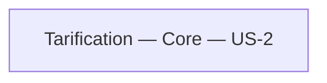

# Context map

## Contexte existant

| Bounded context | Sous-domaine | Langage | Histoire |
|---|---|---|---|
| Tarification | Core | Panier, LigneDePanier, Quantite, Montant, palier, remise, chiffrage | US-2 |

Tarification porte les règles commerciales spécifiques au produit : ADR-001, section Contexte, et recherche US-2 du 2026-11-06, « Key discoveries ». La classification Core décrit cette responsabilité, sans créer une nouvelle frontière ou un service.

`Tarification.Domaine` et `Tarification.Application` sont des couches du même bounded context, pas deux contextes. Aucun catalogue, configuration distante, paiement ou livraison n'est introduit par US-2. Les paliers fournis ne constituent pas un contexte indépendant.

Il n'y a qu'un contexte dans le périmètre documenté : aucune paire, donc aucune relation Upstream/Downstream, ACL, Shared Kernel, Conformist ou OHS/Published Language à ajouter. La recherche et le structural scan n'identifient aucune intégration nécessaire pour US-2.

## Conséquences US-2

Le calcul commercial reste en Domain et l'entrée Query en Application, conformément à ADR-001 et ADR-003. Aucun changement de frontière existante ni nouvelle unité de déploiement.
