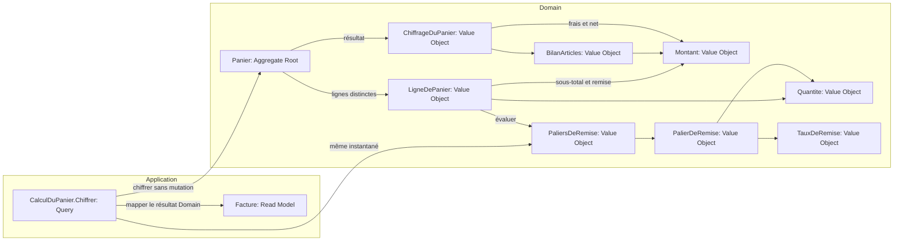

# Tactical design — Tarification

## Sources et décisions

ADR-001 fixe Domain et Application ; ADR-003 classe `CalculDuPanier.Chiffrer` comme Query et `Facture` comme Read Model sur le `Panier` existant (Aggregate Root). Recherche US-2 du 2026-11-06 : « Key discoveries » et « Handoff to DESIGN ». Le structural scan ne détecte ni bus, ni Event Sourcing, ni saga.

## Agrégat existant : Panier

- **Root :** `Panier`, réutilisée ; aucune nouvelle identité ou durée de vie persistée.
- **Frontière de cohérence :** ses lignes restent distinctes ; chaque calcul observe le même instantané de lignes et le même instantané de paliers. Aucun regroupement de références ni modification des prix.
- **Invariants :** quantités positives et montants non négatifs restent ceux des Value Objects existants. La remise d'une ligne est comprise entre zéro et son sous-total ; la remise totale ne dépasse pas la somme des articles.
- **Accès :** le cas d'usage appelle le comportement de chiffrage de la root ; celle-ci délègue le calcul par ligne à `LigneDePanier`. La Query ne modifie aucune ligne.
- **Repository :** aucun dépôt existant n'est rapporté par la recherche ; US-2 n'introduit aucune lecture/écriture persistée. Le contrat de dépôt est non applicable à cette slice de calcul sur une root déjà fournie. Aucun dépôt factice, interface I/O ou implémentation Infrastructure n'est ajouté. Le placement Domain d'un futur dépôt d'agrégat serait la baseline, mais aucune signature ou décision de persistance n'est engagée ici.

`LigneDePanier` est une valeur de ligne sans identité propre, réutilisée comme Value Object ; la recherche établit ses données et son sous-total. Son contrat nouveau est comportemental uniquement : aucun changement de son constructeur ou de sa représentation existante n'est prescrit.

## Valeurs et calcul

Tous les Value Objects sont immuables, égaux par valeur et auto-validants. Les collections nouvelles sont copiées en instantanés immuables.

| Concept | Classification | Responsabilité |
|---|---|---|
| Montant | Value Object | Decimal en euros non négatif ; ajouter taux et soustraction vérifiée sans changer cet invariant. |
| Quantite | Value Object | Entier strictement positif existant, utilisé aussi comme seuil. |
| TauxDeRemise | Value Object | Pourcentage decimal entre 0 et 100 inclus ; aucune représentation binaire flottante. |
| PalierDeRemise | Value Object | Deux attributs : seuil Quantite et taux TauxDeRemise. |
| PaliersDeRemise | Value Object | Un attribut : collection immuable de PalierDeRemise ; vide admis, ordre sans effet, seuils répétés admis. |
| BilanArticles | Value Object | Deux attributs Montant : articles et remise ; remise ≤ articles. |
| ChiffrageDuPanier | Value Object | Deux attributs : BilanArticles et fraisDePort Montant ; montant à payer calculé, pas stocké. |

La root calcule les sous-totaux et remises par ligne, les additionne et retourne `ChiffrageDuPanier`. `LigneDePanier` choisit le taux maximal admissible dans le même `PaliersDeRemise`. `ChiffrageDuPanier` calcule `articles − remise + fraisDePort` dans Domain. Les frais de port restent nuls dans l'implémentation actuelle ; US-2 n'en ajoute aucune règle.

Application mappe uniquement les valeurs calculées dans `Facture`, sans réécrire la formule commerciale. Le calcul conserve la précision decimal existante ; ni arrondi par ligne ni arrondi final nouveau (recherche, découverte sur US-5).

## Entrée applicative et compatibilité

- `CalculDuPanier.Chiffrer` : Query directement appelée, panier et paliers requis dans la forme étendue.
- La forme existante recevant seulement le panier reste disponible et équivaut exactement à des paliers vides. Pas de paliers implicites 10/5 ou 50/12.
- `Facture` : Read Model existant, mêmes totaux ; le montant à payer est désormais le montant net calculé en Domain.
- Aucun Command, Domain Event, Domain Service, bus, projection persistée ou fournisseur de configuration.

## Component diagram

Chaque nœud porte exactement une catégorie. Les sous-graphes décrivent les couches d'ADR-001, pas de nouveaux contextes.

