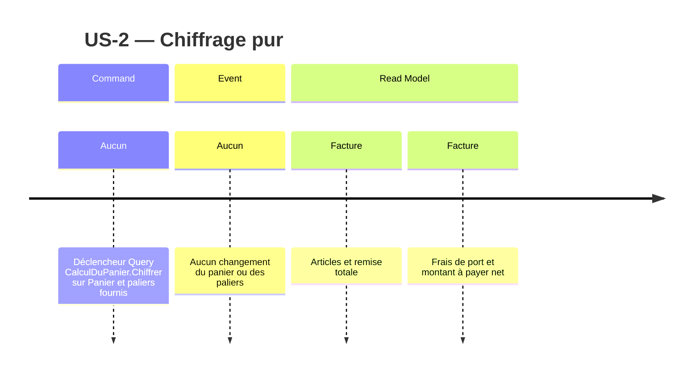

# Event model — Tarification

## Sources et périmètre

- US-2, critères 1–5 : paliers communs, admissibilité par quantité de ligne, une seule remise maximale, absence de palier.
- Recherche US-2 du 2026-11-06, « Key discoveries » et « Handoff to DESIGN » : panier et sous-totaux existants, règles dans le domaine, résultat applicatif existant, arrondis réservés à US-5.
- Clarification humaine consignée dans la recherche : la remise se soustrait du montant à payer.
- ADR-001 : domaine sans dépendance et orchestration applicative ; `Montant` et `Quantite` sont des Value Objects.
- ADR-003 : `CalculDuPanier.Chiffrer` est une Query ; `Panier` est l'Aggregate Root existante, `Facture` le Read Model.

## Slice US-2 — Voir le prix avec remise de quantité

Une seule slice, livrable sans enregistrement de vente ni gestion des paliers. Ses cinq variantes couvrent tous les critères.

| Étape | Classification | Description |
|---|---|---|
| État fourni | Aggregate Root : Panier | Lignes distinctes du panier existant, avec leurs quantités et sous-totaux. La Query ne les modifie pas. |
| Entrée commune | Value Object : PaliersDeRemise | Instantané fourni par l'appelant pour toutes les références ; vide si aucun palier n'est configuré. |
| Déclencheur | Query : CalculDuPanier.Chiffrer | Recevoir le panier et les paliers, calculer et retourner le chiffrage. |
| Command | Aucune | Le calcul n'achète, n'enregistre et ne configure rien. |
| Domain Event | Aucun | Aucun changement d'état, donc aucun événement de succès ou de rejet. Une remise calculée n'est pas un événement enregistré. |
| Résultat visible | Read Model : Facture | Montant des articles, remise totale, frais de port existants et montant à payer. |

`Quantite` détermine l'admissibilité ; `Montant` porte les sous-totaux, remises et totaux. Les règles existantes `Panier` et `LigneDePanier` restent dans Domain ; `CalculDuPanier` et `Facture` restent dans Application.

### Résultats attendus

| AC | Entrées | Remise | À payer, frais de port actuels nuls |
|---|---|---|---|
| 1 | 9 × 2 €, palier 10 / 5 % | 0 € | 18 € |
| 2 | 10 × 2 €, palier 10 / 5 % | 1 € | 19 € |
| 3 | 50 × 2 €, paliers 10 / 5 % et 50 / 12 % | 12 € | 88 € |
| 4 | Deux lignes de références différentes, chacune 6 × 2 €, palier 10 / 5 % | 0 € | 24 € |
| 5 | Paliers vides | 0 € | Somme des articles |

Pour chaque ligne : retenir le taux maximal parmi les paliers dont le seuil est atteint, et non nécessairement le seuil le plus élevé. Aucun cumul ni regroupement de lignes. En cas de taux égaux, le montant reste identique : aucun choix observable de palier n'est requis.

Les entrées invalides échouent par les invariants des Value Objects, sans mutation ni événement. Aucun arrondi nouveau ; les exemples US-2 sont exacts au centime.

Les sections Command et Event indiquent explicitement leur absence ; elles ne reclassent pas le déclencheur Query.
